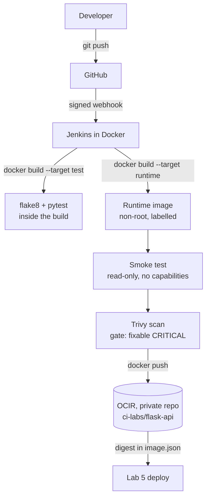

# docker-build-push-ocir

Container image CI on Oracle Cloud Infrastructure. A push to `main` triggers Jenkins through a GitHub
webhook. Tests run inside the image build; the runtime image is tagged with the git commit, smoke-tested
as a locked-down container, scanned for vulnerabilities, and pushed to **OCI Container Registry (OCIR)**.
The pipeline records the image's immutable **digest**, which Lab 5 deploys.

Lab 4 of a series of CI/CD labs on OCI (GitHub · Jenkins · Docker · Oracle Linux).
The application is the Inventory API from
[Lab 2](https://github.com/abdulzaferdevops/jenkins-flask-api-pipeline), now shipped as an image.

## Architecture



## Image design

| Choice | Why |
|:--|:--|
| Multi-stage: `test` → `build` → `runtime` | A failing test stops the build before an image exists; the runtime image carries no compilers or test tools |
| Non-root user, fixed UID `10001` | Predictable for Podman and OKE security contexts |
| `RELEASE` file baked in from build args | `/health` reports the exact build, so deploys can verify what is running |
| OCI labels (`revision`, `source`, `version`, `created`) | Every image traces back to its commit and pipeline run |
| `HEALTHCHECK` | Container runtimes can tell a running process from a working service |
| `.dockerignore` | Keeps `.git`, keys and local files out of the build context |

## Pipeline

| Stage | What it does |
|:--|:--|
| Preflight | Checks Docker access and the registry settings; names the release `<build>-<commit>` |
| Test in build | Builds only the `test` stage: `flake8` and `pytest` inside the image build |
| Build image | Builds the `runtime` stage with release, commit and build time |
| Container smoke test | Runs the image **read-only, with all Linux capabilities dropped and no-new-privileges**; checks `/health` reports this release, and calls the API |
| Vulnerability scan | Trivy report (HIGH + CRITICAL) archived; **build fails on fixable CRITICAL findings** |
| Push to OCIR | Pushes `:<commit>` and `:<release>` tags; records the **digest** in `image.json` (archived, fingerprinted) |

## Registry details

- **Private** repository `ci-labs/flask-api`, created ahead of time in the lab compartment. Pushing to a
  repository that doesn't exist yet would auto-create it in the tenancy's **root** compartment.
- The region is a dedicated region in its own realm, so the registry host is the realm-specific
  `ocir.<region>.oci.<realm-domain>` form rather than `<key>.ocir.io`.
- Registry host, namespace and credentials live in Jenkins, not in this repo.

## Security choices

- Registry login uses a **temporary Docker config** created for the push and deleted straight after,
  so no credentials remain on the Jenkins server's disk.
- Token stored as a masked Jenkins credential; never echoed or passed on a command line.
- Images are deployed by **digest**, not by a tag that could be moved.
- Smoke test runs the container the way production should: read-only filesystem, no capabilities.

## Run locally

```bash
docker build --target test .                      # lint + tests
docker build -t inventory-api --build-arg RELEASE=local .
docker run --rm -p 8000:8000 --read-only --tmpfs /tmp --cap-drop ALL inventory-api
curl http://localhost:8000/health
```

## Licence

MIT
